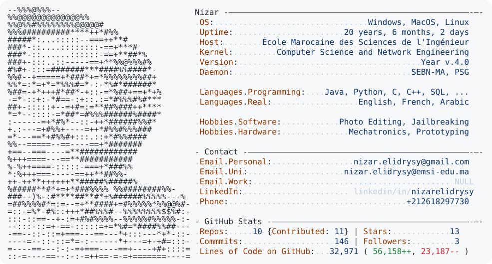

<picture>
  <source media="(prefers-color-scheme: dark)" srcset="dark_mode.svg">
  <source media="(prefers-color-scheme: light)" srcset="light_mode.svg">
  
</picture>

---

# AI & Data Science Engineering Student at EMSI

---

# Technical Skills

| Category | Technologies & Tools |
| :--- | :--- |
| **Programming Languages / Frameworks** | C, C++, Java, Python, HTML/CSS/JS, PHP, Django, React, Node.js |
| **Databases** | SQL, PL/SQL, T-SQL, NoSQL, MongoDB, MySQL, neo4j, redis, Cassandra |
| **Networks & Systems** | IPv4/IPv6, DNS, TCP/IP, UDP, OSI Model, HDLC/PPP, Routing, Cisco IOS, Unix Administration (RHE, Ubuntu, Oracle, etc) |
| **Development Tools** | Git/GitHub, Cisco Packet Tracer, Power BI, WireShark, MySQL, SQLite, MATLAB, VirtualBox, LaTeX, XAMPP, Proteus, Office 365 |
| **Modeling & Design** | UML (Class, Activity, Use Case, Sequence, State Machine), Merise methodology (MCD, MCC, MLD, etc) |

---

# Contact Me

* **Location:** Morocco (Open Geographically)
* **Phone:** [+212618297730](https://api.whatsapp.com/send?phone=212618297730)
* **Email:** [nizar.elidrysy@emsi-edu.ma](mailto:nizar.elidrysy@emsi-edu.ma) | [nizar.elidrysy@gmail.com](mailto:nizar.elidrysy@gmail.com)
* **LinkedIn:** [linkedin.com/in/nizarelidrysy](https://linkedin.com/in/nizarelidrysy)
